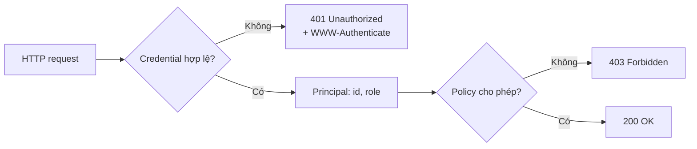
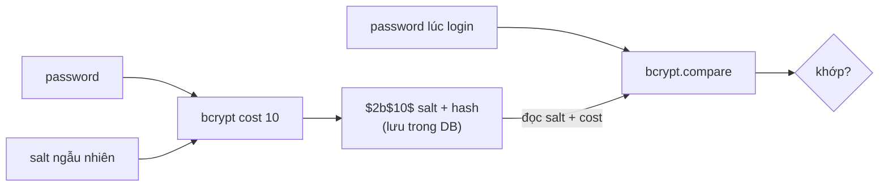
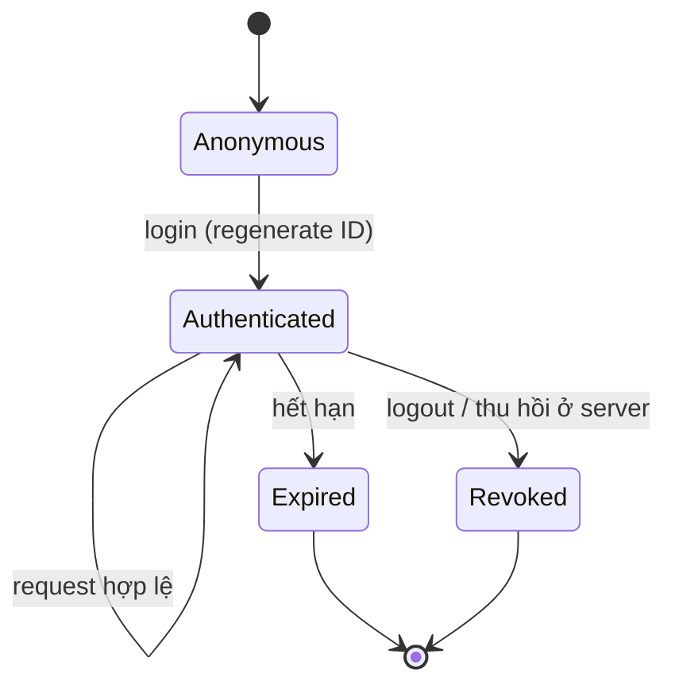
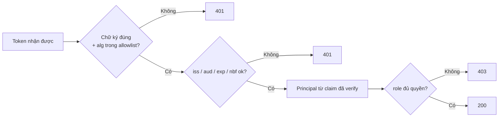
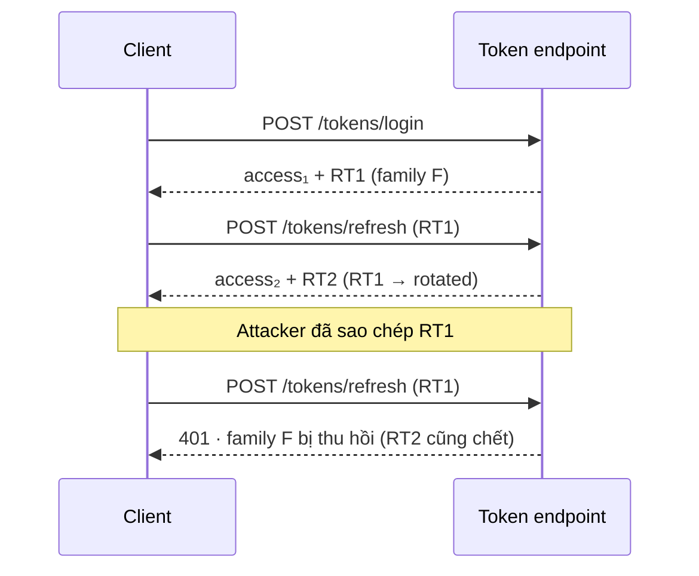
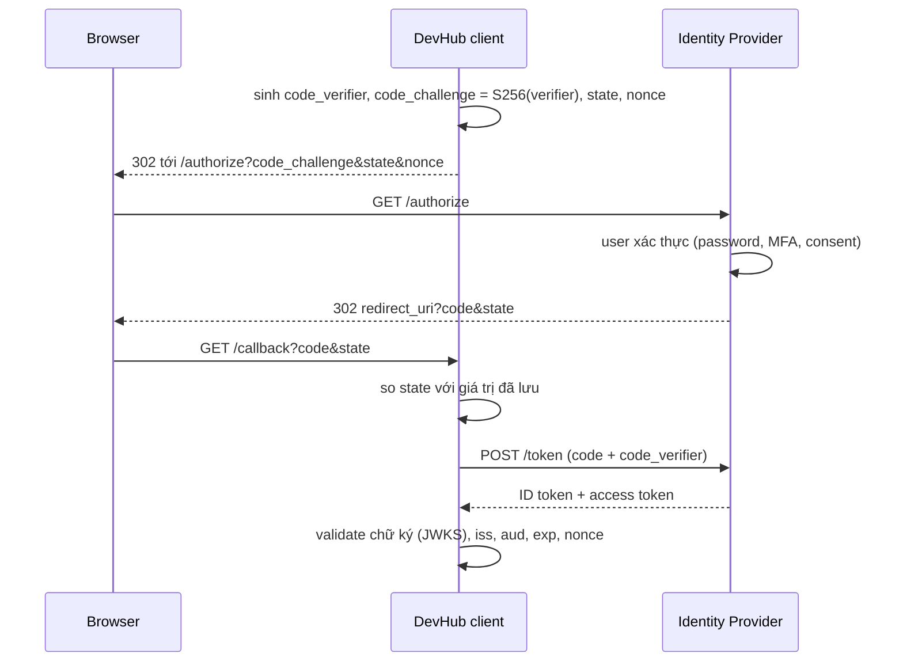

# Break the Login — Authentication Core

Tài liệu lý thuyết cho buổi sharing 90 phút. Bối cảnh xuyên suốt: **DevHub**, một web app nội bộ (React + NestJS API) có hai role `member` và `admin`.

- Slide và speaker notes: [`02-slide-content.md`](02-slide-content.md) (sinh tự động từ `slides/deck-content.mjs`).
- Cách chạy demo trên sân khấu: [`03-demo-runbook.md`](03-demo-runbook.md).
- Hiện trạng triển khai và giới hạn: [`04-implementation-plan.md`](04-implementation-plan.md).

Mỗi phần lý thuyết kết thúc bằng demo tương ứng trong `devhub-auth-lab` (`http://localhost:5173/demo/...`). Buổi sharing tập trung vào password, session, token và OIDC.

---

## 1. Mục tiêu học tập

Sau buổi sharing, người tham gia có thể:

- Phân biệt Authentication và Authorization, và đọc đúng `401` với `403`.
- Giải thích vì sao password phải được hash bằng thuật toán chuyên dụng, salt dùng để làm gì, và vì sao hashing không thay thế rate limiting.
- Mô tả session-based authentication, vai trò của từng cookie flag, session lifecycle, session fixation, CSRF và XSS.
- Đọc cấu trúc JWT, phân biệt **decode** với **verify**, và biết claim nào phải được kiểm tra.
- Phân biệt access token với refresh token; giải thích rotation, reuse detection và revocation.
- Phân biệt OAuth 2.0 với OpenID Connect, ID token với access token; mô tả Authorization Code Flow + PKCE; biết SAML đứng ở đâu trong enterprise SSO.
- Chọn session hay JWT dựa trên threat model và yêu cầu vận hành thay vì theo xu hướng.

## 2. Lịch trình 90 phút

| Phút | Chủ đề | Slide | Demo |
|---|---|---|---|
| 00–07 | Mở đầu: agenda + ba ticket "bug login" | 1–3 | — |
| 07–14 | Authentication, Authorization, 401/403 | 4–5 | Demo 1 · `/demo/authz` |
| 14–24 | Password hashing, salt, brute-force | 6–7 | Demo 2 · `/demo/password` |
| 24–44 | Session, cookie, lifecycle, CSRF/XSS | 8–11 | Demo 3 · `/demo/session`, Demo 4 · `/demo/session/logout-lab` |
| 44–61 | JWT, claims, signature, access/refresh | 12–15 | Demo 5 · `/demo/jwt`, Demo 6 · `/demo/tokens` |
| 61–64 | Session hay JWT? | 16 | — |
| 64–80 | OAuth 2.0, OIDC, SSO, SAML | 17–21 | Demo 7 · `/demo/oidc` (live nếu có IdP, nếu không là walkthrough) |
| 79–86 | Chọn kiến trúc, case study | 22–23 | Thảo luận |
| 86–90 | Checklist, exit ticket, tổng kết | 24–26 | — |

Nếu thiếu thời gian, ưu tiên theo thứ tự: `401`/`403` → hash và verify password → session và logout → JWT tampering → access/refresh token. Demo OIDC có thể rút gọn thành sơ đồ (nhất là khi chưa cấu hình IdP và trang chỉ là walkthrough).

---

## 3. Authentication và Authorization

### 3.1 Hai câu hỏi khác nhau

- **Authentication (AuthN)** — *Bạn là ai?* Xác minh danh tính của người dùng hoặc hệ thống. Ví dụ: server kiểm tra email và password khớp với tài khoản đã đăng ký, rồi xác định được user tương ứng.
- **Authorization (AuthZ)** — *Bạn được làm gì?* Quyết định một principal **đã xác thực** được phép thực hiện hành động nào. Ví dụ: `member` xem được project; chỉ `admin` quản lý được user.

Kết quả của AuthN là một **principal** (`{ id, role, ... }`). AuthZ dùng principal đó cộng với policy để ra quyết định.



### 3.2 Đọc đúng 401 và 403

| Tình huống | Status thường dùng |
|---|---|
| Gọi API cần đăng nhập mà không có credential | `401` |
| Access token sai chữ ký, hết hạn, sai issuer/audience | `401` |
| Session đã bị revoke hoặc hết hạn | `401` |
| Member đã xác thực gọi API admin | `403` |
| Admin gọi API admin | `200` (hoặc status phù hợp với hành động) |

`401 Unauthorized` có tên gây nhầm: thực chất nó nghĩa là *chưa xác thực được*. Response nên kèm header `WWW-Authenticate` cho client biết cách xác thực. `403 Forbidden` nghĩa là server biết bạn là ai nhưng từ chối hành động; login lại không thay đổi được kết quả.

Đây là quy ước phổ biến, không thay thế việc đọc HTTP semantics và contract của từng API. Một số API cố ý trả `404` thay cho `403` để không tiết lộ resource tồn tại.

### 3.3 Lỗi triển khai thường gặp

- Chỉ ẩn nút admin trên frontend, backend không kiểm tra quyền.
- Coi "đã login" là "được làm mọi thứ".
- Đọc role từ dữ liệu client gửi lên (body, header tự đặt, claim chưa verify).
- Trả `200` kèm thông báo lỗi trong body mà không có quy ước rõ ràng.
- Thông báo lỗi login tiết lộ email có tồn tại hay không.

> **Demo 1 — `/demo/authz`.** Gọi `GET /api/me` khi chưa login (`401`), login bằng member (`201`), gọi `/api/me` (`200`), gọi `/api/admin` bằng member (`403`), login admin, gọi `/api/admin` (`200`). Mọi status code đến từ backend (`ApiController`). Phần dưới lặp lại cùng quy tắc với Bearer token.

---

## 4. Password hashing

### 4.1 Vì sao không lưu plaintext

Nếu database chứa password plaintext và bị lộ, attacker dùng được ngay các password đó, và thử chúng trên dịch vụ khác vì người dùng hay dùng lại password. Rủi ro không dừng ở một ứng dụng.

### 4.2 Hashing khác encryption

- **Encryption** đảo ngược được nếu có key. Lưu password dạng mã hoá nghĩa là ai có key thì đọc được mọi password.
- **Hashing** là biến đổi một chiều. Khi login, server không cần giải mã: hàm verify băm lại password người dùng nhập theo cùng tham số và so sánh với hash đã lưu.

Dùng thuật toán **chuyên dụng cho password** và **chậm có chủ đích**: Argon2id hoặc bcrypt (lab dùng bcrypt qua `bcryptjs`). Không dùng SHA-256 thuần: hash tổng quát được thiết kế để nhanh, nên attacker có GPU thử được hàng tỉ lần mỗi giây khi đoán offline. Không tự thiết kế thuật toán.

Cost factor của bcrypt tăng 1 thì công việc tăng khoảng gấp đôi. Chọn cost bằng cách đo trên phần cứng thật (`npm run lab:password` trong lab).

### 4.3 Salt

Salt là giá trị ngẫu nhiên, riêng cho từng hash:

```text
Hash lần 1 = H(password, salt_A)  →  $2b$10$<salt_A 22 ký tự><hash>
Hash lần 2 = H(password, salt_B)  →  $2b$10$<salt_B 22 ký tự><hash>
```

Cùng password nhưng hai hash khác nhau. Salt **không bí mật**; bcrypt lưu thuật toán, cost và salt ngay trong chuỗi hash. Salt làm vô hiệu bảng tra sẵn (rainbow table) và khiến hai user cùng password không lộ ra là giống nhau.



### 4.4 Brute-force và credential stuffing

- **Brute-force**: thử rất nhiều password cho một tài khoản.
- **Credential stuffing**: dùng cặp email/password bị lộ từ dịch vụ khác để thử đăng nhập.

Hashing chỉ tăng chi phí **đoán offline** khi DB đã lộ. Nó **không** bảo vệ endpoint login online. Cần thêm: rate limiting và backoff, giám sát đăng nhập bất thường, MFA hoặc passkey, kiểm tra password đã bị lộ, và tránh khoá tài khoản vô thời hạn (attacker lợi dụng để DoS người dùng thật).

> **Demo 2 — `/demo/password`.** Hash cùng password hai lần (hai chuỗi khác nhau), verify password đúng (khớp) và sai (không khớp). Phần tiếp theo cho thấy bảng SHA-256 không salt bị crack trong mili giây, còn bcrypt cost 12 bị chặn bởi ngân sách thời gian. Lab không có rate limiter; điều đó được nói rõ thay vì trình bày một limiter chưa hoàn chỉnh.

---

## 5. Session-based authentication

### 5.1 Session hoạt động thế nào

HTTP không có trạng thái. Sau khi login, server cần cách nhận ra request tiếp theo là của ai:

1. Browser gửi credential.
2. Server xác minh, **tạo session mới** (regenerate ID) và lưu trạng thái trong session store.
3. Server trả `Set-Cookie` chứa **session ID**, không chứa dữ liệu user.
4. Browser tự gửi cookie ở các request sau.
5. Server tra session ID trong store để biết principal.
6. Logout hoặc hết hạn: server vô hiệu hoá session.

```mermaid
sequenceDiagram
  participant B as Browser
  participant A as DevHub API
  participant S as Session store
  B->>A: POST /session/login (email, password)
  A->>A: verify password (bcrypt)
  A->>S: regenerate ID + lưu {userId, role}
  A-->>B: Set-Cookie: devhub.sid=… (HttpOnly; SameSite=Lax)
  B->>A: GET /api/me + Cookie
  A->>S: tra cứu session ID
  S-->>A: {userId, role}
  A-->>B: 200 {user}
```

Session ID là **bearer credential**: ai cầm được ID thì được coi là user đó, không cần password.

### 5.2 Cookie flags

| Flag | Tác dụng | Không làm được |
|---|---|---|
| `HttpOnly` | JavaScript không đọc được cookie qua `document.cookie` | Không ngăn script độc hại gửi request dưới quyền user |
| `Secure` | Chỉ gửi qua HTTPS | Không có tác dụng nếu site vẫn phục vụ HTTP |
| `SameSite=Lax/Strict` | Hạn chế gửi cookie trong request cross-site | Không thay thế mọi biện pháp CSRF |
| `Path` / `Domain` | Giới hạn phạm vi gửi cookie | `Domain` rộng làm cookie lộ sang subdomain khác |
| `Max-Age` / `Expires` | Thời hạn cookie ở browser | Không thu hồi session phía server |

Lab đặt cookie `devhub.sid` với `HttpOnly`, `SameSite=Lax`, `Max-Age` 15 phút. `Secure` tắt khi chạy HTTP local, bật khi `SESSION_COOKIE_SECURE=true` hoặc `NODE_ENV=production`. Không có cấu hình đúng cho mọi ứng dụng: cần xem HTTPS, domain, frontend có cross-site hay không.

### 5.3 Session lifecycle và fixation



**Session fixation**: attacker khiến nạn nhân dùng một session ID mà attacker đã biết; nếu server giữ nguyên ID đó sau login, attacker đăng nhập theo. Biện pháp: **regenerate session ID sau khi xác thực** (và khi nâng quyền), không chấp nhận session ID do client tự chọn, đặt thời hạn phù hợp.

### 5.4 CSRF và XSS không giống nhau

- **CSRF**: trang khác khiến browser gửi request kèm cookie mà người dùng không chủ đích. Biện pháp: `SameSite` phù hợp, CSRF token, kiểm tra `Origin`/`Referer`, không dùng GET cho hành động thay đổi dữ liệu.
- **XSS**: script độc hại chạy **trong origin** của ứng dụng. Biện pháp: output encoding, sanitization, Content Security Policy, không đưa dữ liệu không tin cậy vào HTML theo cách nguy hiểm.

`HttpOnly` chỉ ngăn đọc cookie; khi đã có XSS, script vẫn gọi API dưới quyền user. `SameSite` không giúp gì với XSS vì request xuất phát từ chính origin.

### 5.5 Logout và revocation

Xoá cookie ở browser **không** có nghĩa server đã vô hiệu hoá session. Nếu server vẫn coi session hợp lệ, mọi bản sao session ID (log proxy, máy bị nhiễm, màn hình chia sẻ) vẫn dùng được. Logout đúng:

1. Huỷ session trong store (`req.session.destroy()`).
2. Gửi cookie hết hạn về browser.
3. Kiểm chứng request tiếp theo với ID cũ bị từ chối (`401`).

> **Demo 3 — `/demo/session`.** Truy cập ẩn danh để lấy ID trước login, login, so sánh ID trước/sau (đã rotate), gọi `/api/me` có và không có cookie, đọc `document.cookie` để thấy `HttpOnly` che cookie, xem bảng giải phẫu cookie.
>
> **Demo 4 — `/demo/session/logout-lab`.** Hai cột: cột A chỉ cho cookie hết hạn, cột B huỷ session ở server. Cả hai đều kết thúc bằng `401` trên browser; replay ID đã sao chép cho thấy cột A vẫn đăng nhập được, cột B bị từ chối.

---

## 6. JWT — cấu trúc, claims và xác minh

### 6.1 Ba phần, ba ý nghĩa

```text
base64url(header) . base64url(payload) . signature
```

- **Header**: metadata, ví dụ `{"alg":"HS256","typ":"JWT"}`.
- **Payload**: claims (`sub`, `role`, `exp`, ...).
- **Signature**: chứng minh header + payload không bị sửa và được ký bằng key mà server tin.

Payload chỉ được **Base64URL-encode**, không được mã hoá. Ai cũng đọc được; không đặt dữ liệu bí mật trong JWT đã ký.

### 6.2 Decode không phải verify

Decode thành công **không** chứng minh: chữ ký hợp lệ, token do issuer mong đợi phát hành, token dành cho API này, token chưa hết hạn, hay claim đáng tin. Backend phải verify với thuật toán và policy cố định trước khi đọc bất kỳ claim nào.

### 6.3 Claims cần validate

| Claim | Ý nghĩa | Lab DevHub kiểm tra |
|---|---|---|
| `sub` | Subject: token nói về ai | Có, và user phải tồn tại |
| `iss` | Issuer: ai phát hành | Phải là `devhub-auth-lab` |
| `aud` | Audience: token dành cho ai | Phải là `devhub-api` |
| `exp` | Hết hạn | Bắt buộc; mặc định 120 giây |
| `nbf` / `iat` | Chưa có hiệu lực / thời điểm phát hành | Từ chối token chưa đến `nbf` |
| `jti` | ID của token | Sinh bằng `randomUUID()` |
| `alg` (header) | Thuật toán ký | Chỉ chấp nhận `HS256` |

### 6.4 Signature và thuật toán

- Cố định danh sách thuật toán được chấp nhận (allowlist) ở server; không để header của token quyết định.
- Từ chối `alg: none` với mọi token cần chữ ký. Lỗ hổng `alg: none` xảy ra khi verifier chấp nhận token không ký hoặc chọn thuật toán theo header, không phải mọi thư viện hiện đại đều mắc.
- Validate `iss`, `aud`, `exp` và claim bắt buộc.
- Dùng thư viện được maintain (lab dùng `jsonwebtoken`); không tự viết.

### 6.5 Tampering

Token member hợp lệ có payload `{"sub":"user-123","role":"member"}`. Attacker sửa thành `"role":"admin"`. Vì không có signing key, attacker không tạo được chữ ký mới; chữ ký cũ không còn khớp nên server phải trả `401`. Token member **hợp lệ** gửi tới endpoint admin thì nhận `403`: xác thực thành công nhưng không đủ quyền.



> **Demo 5 — `/demo/jwt`.** Chọn token mẫu (hợp lệ, sửa role, `alg: none`, HS384, hết hạn, sai issuer, sai audience, chưa có hiệu lực), verify bằng **Verifier chặt** (có trace từng bước) và **Verifier ngây thơ** (chỉ decode, chấp nhận tất cả, để so sánh). Gửi token trong editor tới `/api/me` và `/api/admin` thật. Token mẫu là fixture do lab ký bằng secret local, có thời hạn ngắn; signing secret không bao giờ gửi xuống frontend.

---

## 7. Access token và refresh token

### 7.1 Hai token, hai nhiệm vụ

| | Access token | Refresh token |
|---|---|---|
| Dùng để | Gọi API (`Authorization: Bearer`) | Chỉ để xin token mới tại token endpoint |
| Thời hạn | Ngắn (lab: 120 giây, tuỳ chọn 20 giây) | Dài hơn (lab: 30 phút) |
| Dạng trong lab | JWT HS256 | Chuỗi ngẫu nhiên opaque |
| Server lưu | Không cần (verify chữ ký) | Lưu **SHA-256 hash**, không lưu bản gốc |

API phải từ chối refresh token khi nó được gửi như access token.

### 7.2 Rotation và reuse detection

1. Client gửi refresh token hiện tại.
2. Server kiểm tra token còn hiệu lực, cấp access token mới **và** refresh token mới.
3. Token vừa dùng bị đánh dấu `rotated`.
4. Nếu token đã rotate xuất hiện lại, nghĩa là có bản sao: server không biết bên nào là attacker nên **thu hồi cả family**, buộc login lại.



Mọi hệ thống triển khai rotation hơi khác nhau; phải document đúng hành vi đã implement. Lab trả cùng một thông báo `401` chung cho token không tồn tại, hết hạn, đã rotate hay đã thu hồi.

### 7.3 Logout

Xoá token khỏi UI không thu hồi gì. Logout phải thu hồi refresh token (và family của nó) ở server. Access token JWT vẫn dùng được tới khi hết hạn; đó là lý do access token phải ngắn hạn, hoặc cần denylist nếu yêu cầu thu hồi tức thì.

> **Demo 6 — `/demo/tokens`.** Luồng thật (store in-memory): login → gọi API bằng access token (`200`) → gọi API bằng refresh token (`401`) → refresh (`200`, rotate) → dùng lại refresh token cũ (`401`, cả family bị thu hồi) → logout. Cột bên phải hiển thị trạng thái family phía server; token chỉ hiển thị dạng rút gọn.

---

## 8. OAuth 2.0, OpenID Connect, SSO và SAML

Giải thích thuật ngữ **tại chỗ** khi trình bày: OAuth khi nói ủy quyền → OIDC khi nói ID token / login qua IdP → SSO·SAML khi so sánh enterprise.

### 8.1 OAuth 2.0 không đồng nghĩa với login

**OAuth 2.0** = ủy quyền truy cập: cho app A gọi dữ liệu của bạn ở app B trong phạm vi (scope) được cấp (ví dụ DevHub đọc Google Calendar). Không đồng nghĩa màn hình login. Các vai trò: Resource Owner (user), Client (DevHub), Authorization Server / IdP, Resource Server (API).

### 8.2 OpenID Connect

**OIDC (OpenID Connect)** = lớp danh tính trên OAuth 2.0: trả lời “ai vừa đăng nhập?” bằng ID token.

| Token | Dành cho | `aud` | Dùng để |
|---|---|---|---|
| ID token | Client (DevHub) | `client_id` | Biết ai vừa login; tạo session của DevHub |
| Access token | Resource server (API) | API | Gọi API trong phạm vi scope |

Không dùng ID token để gọi API.

### 8.3 Authorization Code Flow + PKCE



Vai trò từng giá trị:

- `state`: gắn callback với request ban đầu của chính browser này; không khớp thì từ chối.
- `nonce`: gắn ID token với lần login này, chống replay ID token.
- `code_verifier` / `code_challenge`: PKCE. Authorization code bị đánh cắp vô dụng nếu không có verifier.
- `redirect_uri`: phải đăng ký trước và so khớp chính xác.

Dùng thư viện OIDC được maintain; việc của mình là cấu hình đúng và kiểm chứng các bước validate trên.

### 8.4 SSO và SAML

- **SSO** = mục tiêu: login một lần ở IdP, vào nhiều app — không phải tên một giao thức.
- **Assertion (SAML)** = giấy xác nhận XML do IdP ký: “user X đã xác thực, dành cho app Y, còn hạn tới …”. **Cùng vai trò với ID token của OIDC** — chứng minh danh tính sau login; khác “bao bì” (XML đã ký vs JWT).

| | SAML Assertion | OIDC ID token |
|---|---|---|
| Định dạng | XML + XML Signature | JWT (JSON + chữ ký) |
| Ai đọc | Service Provider (SP) | OIDC client |
| Mang gì | Subject, Audience, điều kiện thời hạn | `sub`, `aud`, `exp`, `nonce`… |
| Đường về app | Browser POST SAML Response tới ACS | `code` → đổi lấy token tại `/token` |
| Sau khi tin | Tạo session cục bộ của app | Tạo session cục bộ của app |

Luồng SP-initiated (rút gọn): user mở SP → AuthnRequest tới IdP → user xác thực → IdP POST Assertion về ACS → SP verify → session riêng.

SP phải kiểm tra: chữ ký (đúng phần tử), Audience, Destination (= ACS), NotOnOrAfter, InResponseTo. Metadata IdP↔SP trao đổi entityID, ACS URL, certificate trước go-live.

Chọn SAML khi IdP/khách hàng đã cấu hình sẵn; app mới thường ưu tiên OIDC. Không chọn theo “cái nào mới hơn”.

> **Demo 7 — `/demo/oidc`.** Có hai chế độ tuỳ cấu hình của API.
> - **Live** (`LIVE OIDC — REAL IDENTITY PROVIDER`) khi đã điền `OIDC_ISSUER_URL` và `OIDC_CLIENT_ID`: login thật qua IdP bằng Authorization Code + PKCE (`openid-client`). Sau callback, trang liệt kê từng check DevHub đã chạy (`state`, PKCE, chữ ký qua JWKS, `iss`, `aud`, `exp`, `nonce`), rồi `/api/me` trả user `oidc:<sub>` từ session riêng của DevHub.
> - **Walkthrough** (`FLOW WALKTHROUGH — NO REAL LOGIN`) khi chưa cấu hình: không kết nối IdP nào. `code_verifier`, `code_challenge` (SHA-256 thật bằng `crypto.subtle`), `state` và `nonce` được tính trong trình duyệt; mọi traffic IdP là dữ liệu mẫu, được ghi rõ là mẫu. Có nút giả lập callback sai `state` để thấy bước từ chối.

---

## 9. Session hay JWT?

| Tiêu chí | Session (stateful) | JWT access token (stateless) |
|---|---|---|
| Trạng thái | Ở server (session store) | Nằm trong token |
| Revoke | Xoá session, có hiệu lực ngay | Chờ `exp`, hoặc denylist / rotation |
| Scale ngang | Cần store dùng chung | Verify ở bất kỳ đâu có key, nhưng phải quản lý key |
| Rủi ro browser | Cookie tự gửi → cần xét CSRF | Token trong JS → lộ khi có XSS |
| Kích thước | ID nhỏ | Lớn hơn, gửi kèm mỗi request |
| Hợp với | Web app cùng site | Nhiều API, mobile, hệ phân tán |

Không có đáp án đúng tuyệt đối. Chọn theo: loại client, threat model, yêu cầu revoke, scale, SSO, nơi lưu credential, năng lực vận hành và giám sát.

**Case study DevHub** (web app nội bộ, NestJS API, role member/admin, logout phải có hiệu lực, cần audit rõ): session phía server (hoặc OIDC + session của DevHub khi công ty có IdP) đáp ứng yêu cầu "logout có hiệu lực ngay" đơn giản nhất. JWT + refresh hợp lý hơn khi có nhiều API độc lập hoặc client mobile.

---

## 10. Authentication Security Checklist

**Password**
- [ ] Không lưu plaintext; dùng Argon2id hoặc bcrypt với cost đo trên phần cứng thật.
- [ ] Có rate limiting, backoff và giám sát login thất bại.
- [ ] Thông báo lỗi login không tiết lộ tài khoản có tồn tại.

**Session & cookie**
- [ ] Regenerate session ID sau login và khi nâng quyền.
- [ ] Logout huỷ session phía server rồi mới cho cookie hết hạn.
- [ ] Cookie flags phù hợp deployment (`HttpOnly`, `Secure`, `SameSite`, phạm vi `Domain`/`Path`).
- [ ] Đã đánh giá CSRF cho mọi endpoint dùng cookie; có biện pháp phòng XSS.

**JWT**
- [ ] Verify chữ ký với thuật toán allowlist; từ chối `alg: none`.
- [ ] Validate `iss`, `aud`, `exp` (và `nbf` nếu dùng) cùng claim bắt buộc.
- [ ] Không đặt dữ liệu bí mật trong payload.

**Access / refresh**
- [ ] Access token ngắn hạn; refresh token chỉ dùng ở token endpoint.
- [ ] Refresh token được rotate, lưu dạng hash, thu hồi được; phát hiện reuse.

**OIDC**
- [ ] Validate `state`, `nonce`, PKCE, `redirect_uri`, chữ ký, `iss`, `aud`, `exp`.
- [ ] Không dùng ID token để gọi API.

**Chung**
- [ ] Backend enforce authorization; UI chỉ là gợi ý.
- [ ] Không log password, cookie, session ID, token, Authorization header hay secret.
- [ ] Có test cho credential sai, hết hạn, bị sửa và bị thu hồi; test `401` và `403`.

---

## Tài liệu tham khảo

- RFC 9110 — HTTP Semantics (`401`, `403`, `WWW-Authenticate`).
- RFC 7519 — JSON Web Token; RFC 8725 — JWT Best Current Practices.
- RFC 6749 — OAuth 2.0; RFC 7636 — PKCE; OAuth 2.0 Security Best Current Practice.
- OpenID Connect Core 1.0.
- OWASP Cheat Sheets: Password Storage, Session Management, Authentication, CSRF Prevention, JSON Web Token.
- Viblo — [Các phương thức phổ biến dùng Authentication](https://viblo.asia/p/cac-phuong-thuc-pho-bien-dung-authentication-naQZRPGP5vx) (tham khảo cách trình bày flow chart session, token, OAuth/OIDC, SAML).
